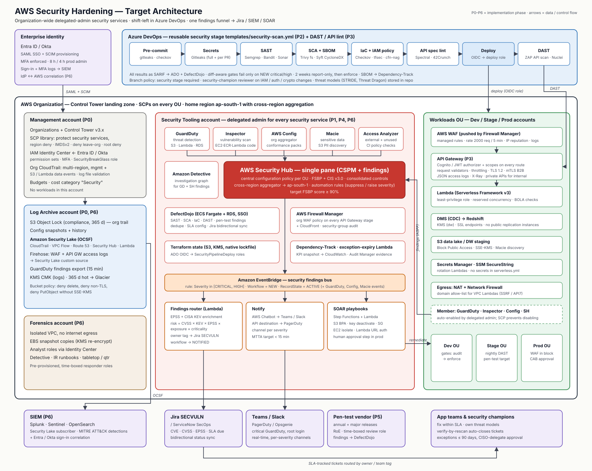
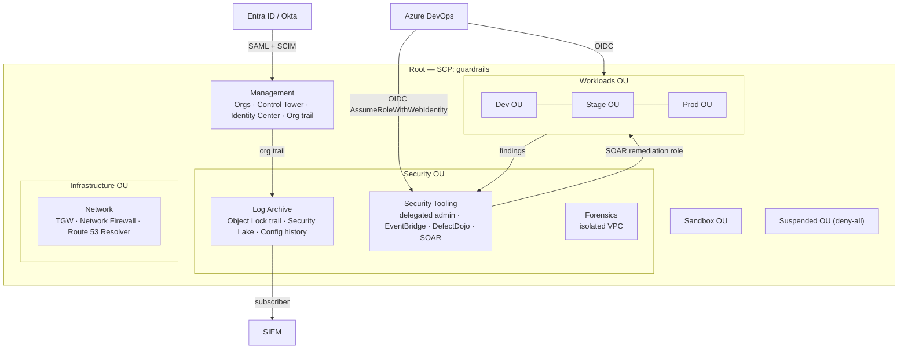
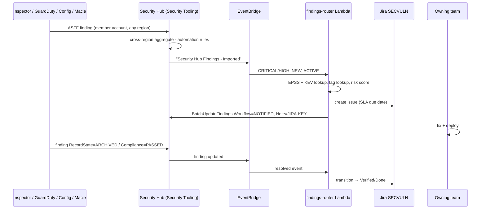

# Target-state security architecture



(PNG export: `aws-security-architecture.png`.)

## 1. Design principles

| Principle | How it shows up in the architecture |
|---|---|
| Organization-wide by default | Every service enabled from the **Security Tooling** account as delegated admin with org auto-enable; new accounts inherit everything on creation |
| Separation of duties | Management account = governance only; Log Archive = immutable evidence; Security Tooling = detection/response; Workloads never hold security admin rights |
| Shift left, verify right | ADO security stage blocks new issues (SAST/SCA/IaC/secrets); runtime services (GuardDuty, Inspector, DAST) confirm in AWS |
| Everything as code | Terraform for services, SCPs, Config rules, WAF, routing; pipeline YAML for scanners; no console changes (Config + CloudTrail detect drift) |
| One findings funnel | Cloud → Security Hub (ASFF); application → DefectDojo; both → EventBridge → Jira with SLAs |
| Least privilege / no long-lived keys | Identity Center for humans, OIDC federation for ADO, IAM roles for workloads; Access Analyzer unused-access tracks drift |

## 2. Account model and trust



### Cross-account roles

| Role | Lives in | Trusted by | Purpose |
|---|---|---|---|
| `SecurityPipelineDeploy` | every account | ADO OIDC issuer, specific service connection subject | Terraform apply for this repo |
| `SecurityAutoRemediation` | every workload account | `SecurityTooling` Step Functions / Lambda roles | Playbook actions (scoped, see `phase-6-integration`) |
| `SecurityReadOnly` | every account | Identity Center permission set | SecOps investigations |
| `PentestCloudReview` | in-scope accounts | vendor principal, `aws:CurrentTime` condition | Time-boxed pen-test configuration review |
| `SecurityBreakGlass` | every account | hardware-MFA IAM users in management account only | Emergency; excluded from SCP denies; alarmed |
| `ProwlerAudit` | every account | Security Tooling | Scheduled CSPM self-assessment |

## 3. Data flows

### 3.1 Findings flow (detect → ticket → verify)



### 3.2 Pipeline flow

```
PR opened ─► Security stage (template) ─► SARIF artefacts ─► DefectDojo reimport (engagement = build)
             │  gitleaks · semgrep · bandit · trivy · syft · checkov · cfn-nag · access-analyzer
             └─ new CRITICAL/HIGH? ── yes ─► build fails, PR annotated
                                     no ──► merge ─► deploy (OIDC role) ─► Stage ─► ZAP baseline (warn)
Nightly ─► ZAP API full scan (Cognito token) + Nuclei weekly ─► DefectDojo ─► Jira
```

### 3.3 Log flow

| Source | Path | Retention |
|---|---|---|
| CloudTrail (mgmt + data) | Org trail → Log Archive S3 (Object Lock) + Security Lake | 365 d compliance lock; Security Lake 365 d → Glacier |
| VPC Flow, Route 53 Resolver | Security Lake native source | 365 d |
| Security Hub findings | Security Lake native source + EventBridge | 365 d |
| WAF logs | Firehose `aws-waf-logs-*` → Log Archive S3 → Security Lake custom source | 365 d |
| API Gateway access logs | CloudWatch → subscription filter → Firehose → Log Archive S3 | 365 d |
| GuardDuty | Publishing destination → Log Archive S3 (KMS) every 15 min | 365 d |
| ADO audit log | ADO audit streaming → SIEM | per SIEM policy |

## 4. API request path (Phase 3 hardened)

```
Client ─TLS1.2─► AWS WAF (FMS-managed ACL: Common, KnownBadInputs, SQLi, IPRep, AnonymousIp, rate 2000/5m)
       ─► API Gateway stage (access log JSON, X-Ray, throttling, usage plan)
           ├─ Cognito / JWT authorizer (scopes per route; admin routes on separate private API)
           ├─ request validator (body + params; reject unknown properties)
       ─► Lambda (least-priv role, reserved concurrency, authz check on every object fetch → BOLA)
           ├─ secrets via Secrets Manager (cached, rotated)
           └─ egress via NAT → Network Firewall domain allow-list (SSRF)
       ─► Redshift / S3 (KMS per domain)
```

## 5. Network egress control for VPC Lambdas

* Lambdas that call third parties run in private subnets; route `0.0.0.0/0` → Network Firewall endpoint → NAT.
* Network Firewall stateful domain list (`STRICT_ORDER`, default drop) allows only the registered third-party domains
  (`*.amazonaws.com` via VPC endpoints where possible).
* Interface VPC endpoints: Secrets Manager, SSM, STS, KMS, Logs, S3 (gateway), DynamoDB (gateway).

## 6. Encryption

| Domain | Key | Used by |
|---|---|---|
| `alias/omni-dw` | CMK, rotation on | Redshift, DMS, DW staging S3 |
| `alias/omni-api` | CMK | Lambda env, DynamoDB, API S3 |
| `alias/security-logs` | CMK in Log Archive | Org trail, Config, GuardDuty export, Security Lake |
| `alias/secrets` | CMK | Secrets Manager, SSM SecureString |

Key policies grant `kms:Decrypt` only to named roles; `kms:ViaService` conditions restrict use to the owning service.
